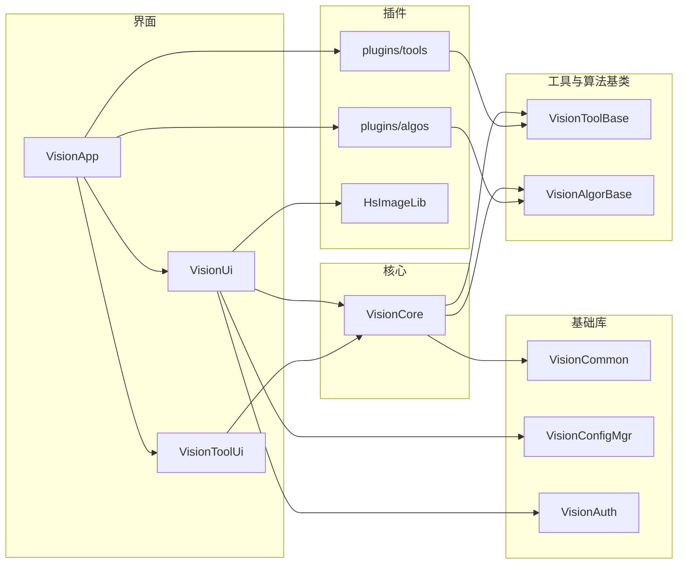
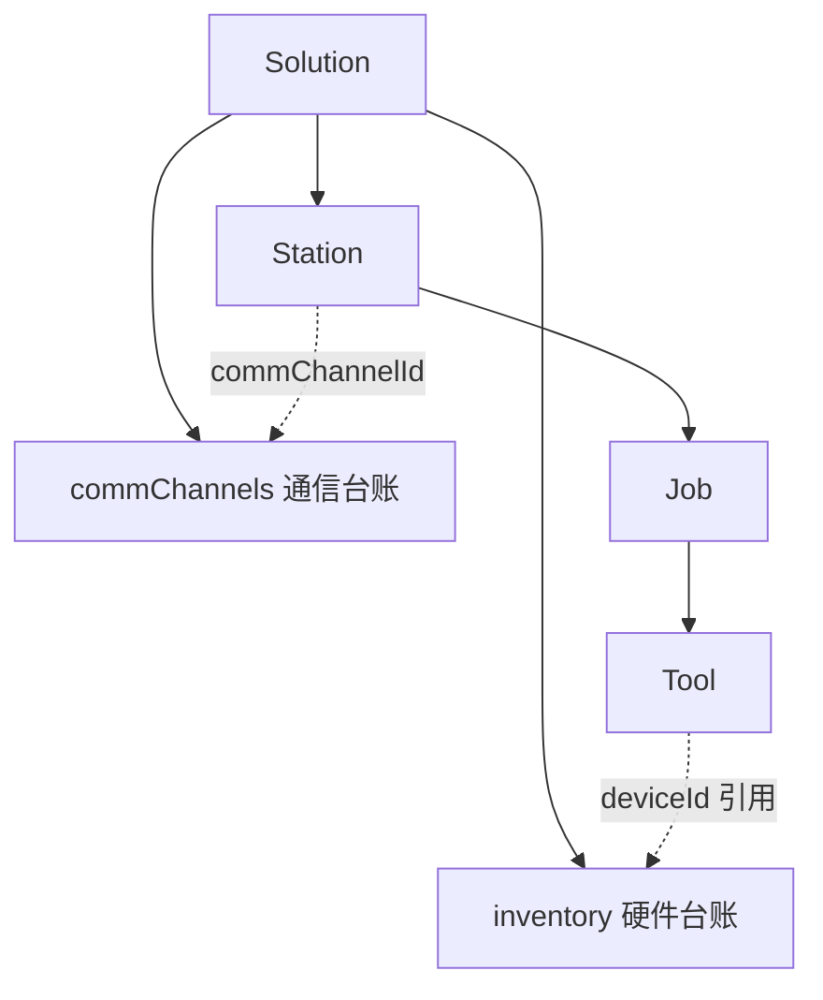
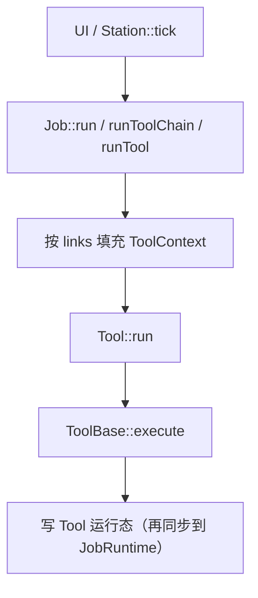
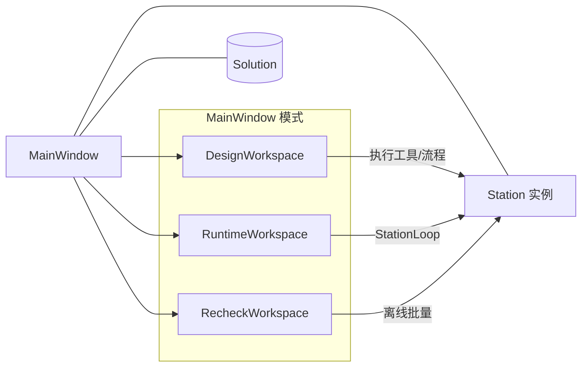
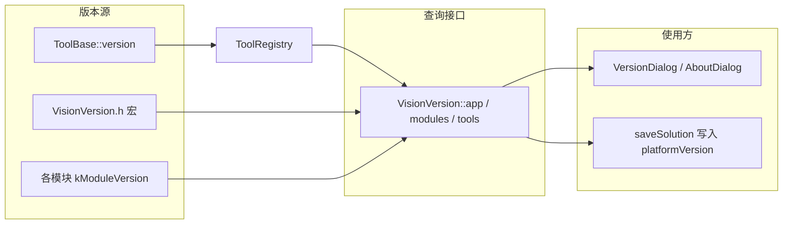

# 架构

本文描述 VisionPlatform 的工程分层、领域模型与关键调用关系。编译与运行见 [../README.md](../README.md)。

---

## 1. 解决方案分层

```text
VisionPlatform.sln
├── Start ........ VisionApp              exe（加载 plugins → Session → MainWindow）
├── HMI .......... HsImageLib / VisionWidgets / VisionUi / VisionToolUi
├── ClassLib ..... VisionCommon / VisionCore / VisionToolBase / VisionAlgorBase /
│                  VisionCommunication / VisionAuth / VisionLog /
│                  VisionLanguage / VisionConfigMgr
├── ImgAlgorithm . plugins/tools / plugins/algos / VisionHalconCommon
└── CamSDK ....... VisionGrabFile
```

| 分组 | 工程 | 职责 |
|---|---|---|
| Start | **VisionApp** | 启动程序：单实例、注册工具与编辑器、进入主窗 |
| HMI | **VisionUi** | 主窗、设计/运行/复检工作区、配置对话框、工站循环 |
| HMI | **VisionToolUi** | `ToolDebugHost`、工具编辑器与编辑器注册 |
| HMI | **VisionWidgets** | 主题等通用控件 |
| HMI | **HsImageLib** | 本方案内图像控件与协议（不链 `HsImage.sln`） |
| ClassLib | **VisionCore** | `Solution` / `Station` / `Job` / `Tool`（动态库；工具与算法插件不链接它） |
| ClassLib | **VisionToolBase** | 工具壳基类、`ToolRegistry`、参数说明 |
| ClassLib | **VisionAlgorBase** | 算法基类、算法登记、`runAlgorToolBase` |
| ClassLib | **VisionCommunication** | 串口 / TCP / MODBUS 通道运行时（`CommMgr`） |
| ClassLib | **VisionCommon** | 版本、路径、ObjectId、参数、线程池 |
| ClassLib | **VisionConfigMgr** | `*.vpsol` / users / settings JSON |
| ClassLib | **VisionAuth** | Session、用户、权限、审计 |
| ClassLib | **VisionLog** / **VisionLanguage** | 日志、国际化 |
| ImgAlgorithm | **plugins\\tools** | 每个工具一个 DLL（如 `Tool.Locate.FindCircle.dll`）。`toolName` 为小写点分名，外壳与算法必须相同 |
| ImgAlgorithm | **plugins\\algos** | 每个 Halcon 算法一个 DLL（如 `Algo.Halcon.FindCircle.dll`）。判定、通信、相机、结果合并没有算法 DLL |
| ImgAlgorithm | **VisionHalconCommon** | Halcon 辅助静态库，链进各算法 DLL，不是插件 |
| CamSDK | **VisionGrabFile** | 文件采集静态库（`FileGrabber`），由相机工具插件链接 |

依赖方向（上层调用下层，禁止反向持有指针）：



---

## 2. 领域模型

业务层级固定为：**方案 → 工站 → 流程 → 工具**（配置结构体与运行时对象一一对应）。

```text
Solution (*.vpsol)
  inventory[]     HardwareDevice          硬件台账（相机 / 控制卡 / PLC）
  commChannels[]  CommChannel             通信台账（串口 / TCP / MODBUS）
  stations[]      StationConfig  → Station (+ StationRuntime)
                    jobs[]        JobConfig → Job (+ JobRuntime)
                      tools[]     ToolConfig → Tool (+ ToolRuntime)
                      links[]     数据连线（图 / 位姿 / 区域 / 逻辑口）
                      root        ToolGroup（执行树：顺序 / 并行 / If）
                      resultRules[] 结果规则矩阵
```



| 概念 | 含义 |
|---|---|
| **Solution** | 项目根：设备台账 + 通信台账 + 工站 + `platformVersion` |
| **Station** | 一个物理/逻辑工位；`tick(sol)` 按 `jobSchedule` 串行或并行执行 Job |
| **Job** | 一次触发要跑完的流程；解析连线、按执行树调度工具、评定结果规则 |
| **Tool** | 最小执行单元，对外入口调用 `ToolBase::execute`（可选 `AlgorToolBase`） |
| **Device** | 台账登记，种类为相机 / 控制卡 / PLC；相机含 `CameraBackend`（文件源 / SDK）；工站用 `DeviceRef` 绑定 |
| **CommChannel** | 方案级通信通道；工站 `commChannelId` 引用；`CommMgr` 负责本机枚举与通断读写 |

强制依赖方向：`Station → Job → Tool`。`Tool` 不持有 `Job*`，`Job` 不持有 `Station*`；上层通过 id 或传入上下文调用。

详细边界见 [`../../docs/Tool综合体-边界与调用.md`](../../docs/Tool综合体-边界与调用.md)。

---

## 3. 运行时调用

流程调度入口在 **Job**；单工具执行只走 **Tool**。



| 层级 | 负责 | 不负责 |
|---|---|---|
| **Job** | 连线解析、组/If 执行顺序、结果规则、`source`/`frameSeq` | Qt、算法实现 |
| **Tool** | 在已填好的输入上调用插件、写本工具缓存 | 解析 `links[]`、调度相邻工具 |
| **ToolBase / 插件** | `execute(ctx)` 具体采集或算法 | 持有 Job/Station |

运行日志走独立通知通道（不构成反向依赖）：

```text
Job / Station ──发出──? RunLogHub ──分发──? MainWindow（Queued → UI）
                                   └──? VisionLogRunSink（写入日志文件）
```

线程概要：

| 场景 | 线程 |
|---|---|
| 设计 / 复检 / DebugHost / 试跑 | `ThreadPool::shared()`（C++ 线程池，非 Qt） |
| 运行态 | 每工站一条 `StationLoop`；并行 Job 进同池再汇总 |
| 回 UI | 堆对象 + `QMetaObject::invokeMethod(..., QueuedConnection)` |

---

## 4. 界面与 Core 的关系



| UI 组件 | 主要编辑 / 展示对象 |
|---|---|
| DesignWorkspace | 资源树、`JobFlowCanvasPanel`、结果只读面板 |
| JobDialog | 流程结构、组/If、结果规则（draft / formal） |
| ToolDebugHost | 单工具参数、ROI、`ToolIoPanel` |
| Device / Comm / Station 对话框 | 设备三类台账、通信通道、工站绑定 |
| SettingsDialog | 本机设置中心（常规/界面/路径/运行日志入口）；非方案数据 |
| RecheckWorkspace | 文件夹批量、结果表、导出 |

**本机设置边界**：菜单「设置」打开 `SettingsDialog`，只改 `AppSettings`（主题、语言、自动登录、启动默认模式等）。用户管理、控件权限、日志管控仍在「系统」菜单（设置页内可跳转）。运行画面配置属方案，仍在「视图」。

配置对话框改的是方案模型；真正执行统一进入 `Station` / `Job` / `Tool`。

---

## 5. 版本流

与 [versioning.md](versioning.md) 一致：三路版本来源汇总到查询接口，再供「关于 / 版本管理」与方案保存使用。



| 层级 | 来源 | 显示 / 写入文件 |
|---|---|---|
| 软件 | `VISION_VERSION_*` → `VISION_VERSION_STRING` | 关于、版本管理、方案 `platformVersion` |
| 模块 | `VISION_MODULE_*_VERSION` | 版本管理「模块」表 |
| 工具 | `ToolBase::version()` → `ToolDesc`，经 `ToolRegistry` | 版本管理「工具」表 |

改号入口：`VisionCommon/common/VisionVersion.h`。工具行为不兼容升级时只改该工具的 `version()`。

---

## 6. 启动注册顺序

`VisionApp` 在进入主窗前只做插件加载，不再直接调用 `registerAlgoBase` / `registerBuiltin`：

```text
loadVisionPlugins（plugins\tools\*.dll 与 plugins\algos\*.dll，VisionPlugin_apiVersion = 1）
        ↓
   ToolRegistry / AlgorRegistry（同一 toolName；优先 halcon，不登记 builtin / dummy）
        ↓
   registerToolEditors（通用参数页，不按工具名登记专用页）
        ↓
   Session（users / settings）→ MainWindow
```

外壳与算法 DLL 的 `toolName` 必须一致（例如 `locate.find_circle`）。无 Halcon SDK 时对应算法 DLL 不加载，图像工具执行返回「未登记图像算法」。

---

## 7. 相关图源

仓库内 PlantUML（可导出 PNG/SVG）在 [`../../docs/diagrams/`](../../docs/diagrams/)：

| 文件 | 内容 |
|---|---|
| `vision-overview.puml` | UI、方案、Runtime 总览类图 |
| `vision-structure.puml` | 方案 / 工站 / Job 结构 |
| `vision-scheme.puml` | 方案领域 |
| `vision-runtime.puml` | 运行时 |
| `vision-schedule.puml` | 调度 |
| `vision-design-ui.puml` | 设计态 UI |
| `vision-tool-facade.puml` | Tool 对外接口 |

文字方案：[`../../docs/09-方案与流程.md`](../../docs/09-方案与流程.md)、[`../../docs/Tool综合体方案.md`](../../docs/Tool综合体方案.md)。
