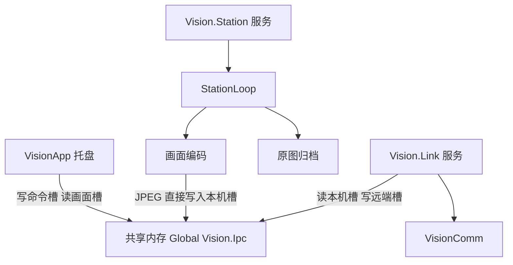
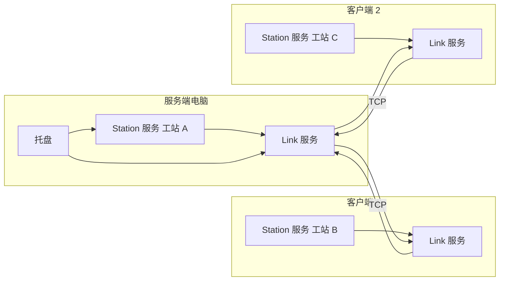
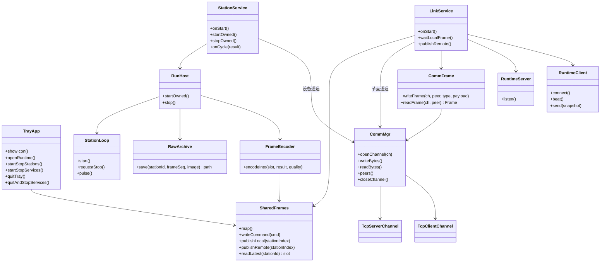
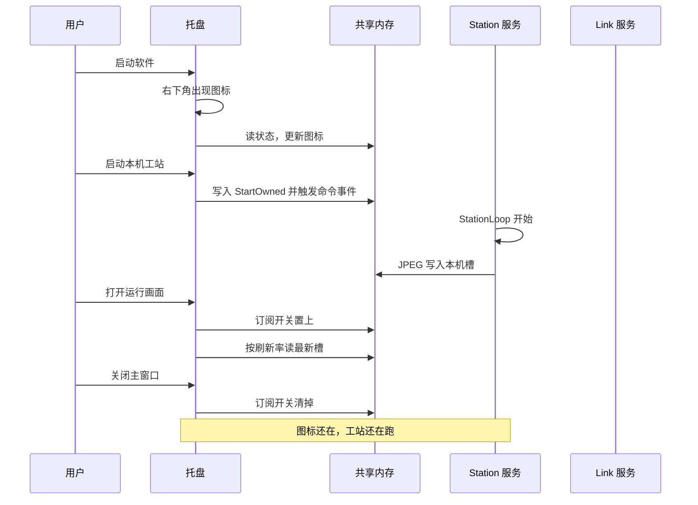
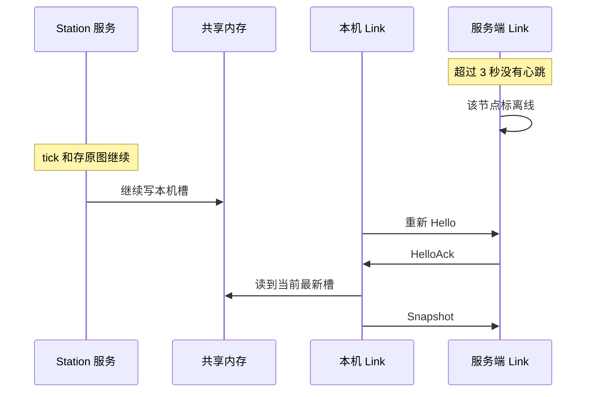

# 运行方式与多端共享方案

日期：2026-10-27。对象是 `VisionPlatform`。本文只定本机总控、Windows 服务和多端共享，不改已有的《VisionPlatform项目评估》和《视觉平台开发阶段对比》。

安装目录里固定三个 exe。Windows 服务只有两个，各由一个 exe 注册而成。`VisionApp.exe` 不是服务。工站增减只改部署表，不增加 exe，也不增加服务。

呈现和组网是两根轴，合在一起决定这台电脑启动哪几个。呈现三选一：界面、控制台、无窗口。组网三选一：单机、服务端、客户端。单机仍是「托盘或控制台 + 工站服务」，只是不启动链路服务，不是把全部功能放进一个进程。

## 1. 三个 exe

| exe | 是不是服务 | 功能 | 不负责 |
|---|---|---|---|
| `VisionApp.exe` | 否 | 人机总控。默认进入界面：右下角托盘、主界面、设计态、运行画面。`--console` 进入控制台：标准输入输出，没有托盘、没有窗口 | 不调用 `Station::tick`，不存原图，不监听节点端口，不打开设备 TCP |
| `Vision.Station.exe` | 注册为服务 `Vision.Station` | 本机工站的节拍、原图落盘、显示用 JPEG 写入共享内存、打开方案里的设备通道（串口、PLC、Modbus）、执行启动/停止/重载命令 | 不画界面，不监听节点端口，不把画面发给别的电脑 |
| `Vision.Link.exe` | 注册为服务 `Vision.Link` | 节点 TCP：监听或连接、心跳、收发 JPEG、把本机槽转发出去、把别人的画面写入远端槽。传输调用 `VisionComm` | 不跑工站，不存原图，不画界面，不打开设备通道 |

`VisionApp.exe` 有两个入口，仍然是同一个文件：

| 启动方式 | 表现 |
|---|---|
| 双击，或登录启动项，无参数 | 界面。先出现托盘，主窗口不自动打开。关掉主窗口回到托盘 |
| `VisionApp.exe --console` | 控制台。打印本机服务和工站状态，接受 `status`、`start`、`stop`、`reload`、`quit`。`quit` 只退出控制台 |

托盘和 `--console` 不要同时开。后启动的发现已有总控，就退出。

## 2. 两个服务

服务名和 exe 一一对应。服务跑在会话 0，所以托盘不能放进服务。

| 服务名 | 对应 exe | 启动后一直做的事 | 停掉之后 |
|---|---|---|---|
| `Vision.Station` | `Vision.Station.exe` | 等命令；收到启动后只跑部署表里属于本机的工站；每拍先存原图，再把 JPEG 写入本机画面槽 | 本机工站停止。`Vision.Link` 还在的话，别的电脑把这台标成离线 |
| `Vision.Link` | `Vision.Link.exe` | 按角色听端口或连接服务端；每秒心跳；本机有新槽就把最新 JPEG 发出去；本机正在看画面时，接收别人的 JPEG | 本机工站继续跑、继续存原图。别的电脑看不到这台的新画面 |

这两个服务拆开，是为了坏一块时另一块还在。链路崩溃或网线拔掉，工站服务继续存原图。工站服务停掉，链路可以还在。用户退出托盘或注销后，已经启动的服务继续跑。

纯看画面、自己没有工站的客户端不安装、也不启动 `Vision.Station`。单机不安装、也不启动 `Vision.Link`。其余机器上，该角色要用的服务设为自动启动。

## 3. 运行模式启动哪几个

行是组网，列是呈现。单元格里是这台电脑要启动的 exe。没写的 exe 不启动。

| 组网 | 界面 | 控制台 | 无窗口 |
|---|---|---|---|
| 单机 | `VisionApp.exe`，`Vision.Station.exe` | `VisionApp.exe --console`，`Vision.Station.exe` | 只启动 `Vision.Station.exe` |
| 服务端，本机有工站 | `VisionApp.exe`，`Vision.Station.exe`，`Vision.Link.exe` | `VisionApp.exe --console`，`Vision.Station.exe`，`Vision.Link.exe` | `Vision.Station.exe`，`Vision.Link.exe` |
| 服务端，本机没有工站 | `VisionApp.exe`，`Vision.Link.exe` | `VisionApp.exe --console`，`Vision.Link.exe` | 只启动 `Vision.Link.exe` |
| 客户端，本机有工站 | `VisionApp.exe`，`Vision.Station.exe`，`Vision.Link.exe` | `VisionApp.exe --console`，`Vision.Station.exe`，`Vision.Link.exe` | `Vision.Station.exe`，`Vision.Link.exe` |
| 客户端，只看画面 | `VisionApp.exe`，`Vision.Link.exe` | `VisionApp.exe --console`，`Vision.Link.exe` | 不部署。没有界面就没有人看 |

无窗口时没有托盘，也没有控制台。工站和链路靠服务自己跑，命令只能等下次有人登录打开界面或控制台再发。

每种组网里，工站服务和链路服务各自做什么：

| 组网 | `Vision.Station` | `Vision.Link` | 人在界面或控制台里看到什么 |
|---|---|---|---|
| 单机 | 跑方案里全部已使能工站 | 不启动 | 只看本机工站 |
| 服务端 | 跑部署表里属于自己的工站；没有则进程不在 | 监听端口，汇集各客户端。0 个客户端时仍然听着 | 全部工站 |
| 客户端 | 跑部署表里属于自己的工站；只看画面时进程不在 | 连接服务端，发心跳，转发本机最新 JPEG | 界面或控制台正在看时才接收别人的 JPEG；无窗口只上报自己的 |

部署表是「工站 id → 节点 id」。同一个工站出现两次，两个服务都不跑它。界面下托盘标红，控制台打出拒绝原因。

客户端的 `Vision.Link` 始终发心跳。只有界面打开了运行画面，或控制台执行了看画面，才向服务端订阅别人的 JPEG。无窗口没有订阅者，这台机器不收别人的图，本机工站照常上报。

服务端的 `Vision.Link` 无论本机有没有人看，都保存各工站最新一帧，并转给仍在订阅的客户端。

远端只能看。开始和停止工站只写进本机共享内存的命令槽，由本机的 `Vision.Station` 执行，不经过服务端转发。

## 4. 界面总控

这一节只描述呈现为「界面」时的 `VisionApp.exe`。控制台和无窗口不出现托盘，见第 3 节的启动表。

用户双击软件，或登录后自动启动 `VisionApp`。图标先出现，主窗口不自动打开。双击图标打开运行画面，右键是菜单。关掉主窗口只是回到托盘。

图标颜色表示这台机器的总状态：

| 颜色 | 含义 |
|---|---|
| 灰 | 本机该运行的服务还没起来 |
| 绿 | 该运行的服务都在，非单机时心跳也正常 |
| 黄 | 本机工站在跑，到服务端的链路断了 |
| 红 | 服务在，但工站报错，或 Hello 被拒绝 |

右键菜单：

- 打开主界面
- 运行画面
- 启动本机工站 / 停止本机工站
- 服务状态（Station、Link 各自在不在）
- 启动服务 / 停止服务
- 退出（只关托盘，服务继续）
- 停止服务并退出

「启动本机工站」只作用在部署表里属于本机的工站，命令发给 `Vision.Station`。托盘自己不调用 `Station::tick`。设计态、改方案仍在 `VisionApp` 里；应用到正在跑的服务之前，先停止本机工站，再让服务重新加载方案。

服务默认随 Windows 启动。托盘起来时如果发现服务没跑，菜单里可以启动。没有权限时菜单保持现状并写出失败原因，不把图标假装成绿色。

托盘是单实例。第二次打开软件只激活已有图标。控制台和托盘不同时运行，见第 1 节。

## 5. 架构



本机三个进程映射同一块共享内存。命令和状态放在头部，画面放在固定槽里。两台电脑之间只走 `VisionComm` 里现成的 TCP 通道，由 `Vision.Link` 调用。`Vision.Link` 里不写套接字。

`VisionComm` 是无界面的类库。同一份库在两个进程里各用一次，状态不共用：

| 进程 | 用 `CommMgr` 打开什么 | 不打开什么 |
|---|---|---|
| `Vision.Station` | 方案台账里的设备通道：串口、PLC 用的 TCP、Modbus | 节点监听端口 |
| `Vision.Link` | 节点设置里的那一条 TCP。服务端是 `TcpServerChannel`，客户端是 `TcpClientChannel` | 设备台账里的 PLC 通道 |

设备通道和节点通道端口不同，协议不同，不放在同一个套接字上。界面里的通信对话框只编辑设备台账，不创建节点端口。给 PLC 用的 Modbus 仍走 `Modbus.h` 里现有的功能码。



用户注销后，图里的托盘消失，六个服务进程还在。客户端继续跑 B、C，服务端继续收图。有人再登录时，托盘重新映射这块共享内存。

## 6. 类



| 类 | 在哪个进程 | 做什么 |
|---|---|---|
| `TrayApp` | `VisionApp` | 图标、菜单、主界面、运行画面。向两个服务发命令 |
| `StationService` | `Vision.Station` | 服务入口。只创建本机拥有的 `StationLoop` |
| `LinkService` | `Vision.Link` | 服务入口。按角色听端口或去连接 |
| `RunHost` | Station 服务内 | 启动和停止本机工站，不打开 TCP |
| `SharedFrames` | 三个进程都映射 | 名字是 `Global\Vision.Ipc`。命令、状态、本机画面、远端画面 |
| `CommMgr` | `VisionComm`，Station 与 Link 各有一份实例 | 按 `CommChannel` 打开串口或 TCP。节点链路和设备链路用同一个入口 |
| `TcpServerChannel` / `TcpClientChannel` | `VisionComm` | 已有的字节收发。`write` 经 `commSendAll` 把一整段送完 |
| `CommFrame` | `VisionComm` 新增 | 在字节通道上收发完整的一帧。Modbus 不用它 |
| `RuntimeServer` / `RuntimeClient` | Link 服务内 | 只组 Hello、心跳和 Snapshot，通过 `CommFrame` 收发 |

`StationLoop` 从 `VisionUi` 挪到 Station 服务所用的无 Qt 运行库。界面不再持有这条线程，也不在界面线程里 `join`。

相机 SDK 要能在不登录的服务会话里采图。做不到的型号不能放进 `Vision.Station`，这项在接具体 SDK 时单独确认。

## 7. 本机进程间通信

同一台电脑上的三个进程用一块共享内存交换命令和画面，名字是 `Global\Vision.Ipc`。`Global\` 才能让会话 0 里的服务和已登录用户的托盘看到同一块。数据不出这台机器，不经过网卡，也不使用 TCP。

TCP 只出现在两台电脑的 `Vision.Link` 之间。单机没有第二台电脑，也就没有这条 TCP。

共享内存适合这条链路，因为要传的是成百上千 KB 的 JPEG，而且只要最新一帧。命名管道每送一次都要拷进内核再拷出来；画面若先到 Link 再转到托盘，一张图要拷两次。本机回环 TCP 还要多走一层协议栈。共享内存里，编码直接写进槽，别的进程映射同一页就能读。内存大小在创建时定死，不会随着节拍越堆越多。

布局分成三部分：

| 区域 | 谁写 | 谁读 | 内容 |
|---|---|---|---|
| 头部 | 托盘写命令；两个服务写状态 | 三个进程都读 | 命令槽、工站状态、链路状态、订阅开关 |
| 本机画面槽 | `Vision.Station` | Link 和托盘 | 本机工站的 JPEG 和叠加 |
| 远端画面槽 | `Vision.Link` | 托盘 | 从网上收到的其它工站最新一帧 |

命令很少，一次就几十字节。托盘把命令写进头部，然后触发自动复位事件 `Global\Vision.Command`。Station 服务平时堵在这个事件上，没有命令时不占 CPU。状态也在头部：托盘每一秒读一次这块内存来改图标颜色，不再为了问状态做一次往返。

每个本机工站 3 个槽，每个远端工站 2 个槽。槽的字节数由设置 `previewSlotBytes` 决定，默认 1 MB。JPEG 加上叠加超过槽大小时，这一拍画面不发布，状态里记一笔，原图照常保存。3 个槽用来让写的人避开正在被读的那一槽：写完把发布序号改成新槽。读的人看到序号是奇数就说明正在写，换一次再读。这样不加锁盖住整张图。

内存上限可以算出来。2 个本机工站、8 个远端工站、槽 1 MB 时，大约是 `2×3×1 + 8×2×1 = 14` MB，加上头部可以忽略。没有工站在跑时，这块内存仍然占着，但不会再涨。

编码写进当前槽，不先在堆上留一整张副本。Link 发往别的电脑时，把这一槽交给 `CommFrame::writeFrame`，由已有的 `commSendAll` 送完。托盘的运行画面按自己的刷新率读最新槽，建议 15 帧每秒，不跟着工站每一拍解码。工站更快时，中间帧留在槽里被下一帧盖掉。

Link 用事件 `Global\Vision.FrameReady` 等待新帧，没有新帧就睡眠。Link 没启动时，Station 仍然把最新 JPEG 留在本机槽里，不等待任何人，节拍不减速。原图在写入共享内存之前已经落盘。

订阅开关放在头部。运行画面打开时托盘把它置上，Link 才向服务端要别人的 JPEG，并写入远端槽。画面关上就清掉，网上不再往这台机器送别人的图。

命令只有这些，都写在头部的命令槽里：

| 命令 | 谁写 | 作用 |
|---|---|---|
| StartOwned | 托盘 | 启动部署表里属于本机的工站 |
| StopOwned | 托盘 | 只停止这些工站 |
| Reload | 托盘 | 工站已停止时重新读方案 |
| SetSubscribe | 托盘 | 打开或关闭接收其它工站的 JPEG |

服务由谁创建这块内存：Station 和 Link 谁先启动谁创建，后启动的直接打开。纯看画面的客户端没有 Station，由 Link 创建。单机没有 Link，由 Station 创建。访问权限要允许服务账号和当前登录用户读写。

## 8. 现场连接复用 VisionComm

节点之间的 TCP 不新写套接字，只调用 `VisionComm`。`Vision.Link` 在内存里组一条 `CommChannel`，交给 `CommMgr::openChannel`。

| 角色 | `CommChannel.type` | 参数 |
|---|---|---|
| 服务端 | `CommTcpServer` | `port` = `listenPort` |
| 客户端 | `CommTcpClient` | `host`、`port`，并打开自动重连 |
| 单机 | 不调用 `openChannel` | — |

`TcpServerChannel` 已经能监听、按 `peerId` 区分多个客户端、用 `commSendAll` 把一整段字节写完。`TcpClientChannel` 已经能连到主机和端口。这些留在原类里用。`readBytes` 现在返回的是手头有的一段字节，不是一整帧；Modbus 在 `Modbus.cpp` 里自己拼帧。节点帧和 Modbus 帧不一样，不能塞进 Modbus 拼帧，也不要在 `Vision.Link` 里再写一遍粘包处理。

因此在 `VisionComm` 里补一个 `CommFrame`，供节点链路使用，也留给以后别的定长头协议：

- `writeFrame` 按下面的头把类型和负载交给通道的 `write`。
- `readFrame` 反复 `read`，直到头和负载都齐，再返回一帧。半包留在 `CommFrame` 自己的缓冲里。
- 负载超过 8 MB，或对端关掉，关闭这个 `peerId`。

`VisionComm` 里还要补三处，否则节点链路用现在的 TCP 服务端会卡住：

| 现有行为 | 要改成 |
|---|---|
| `TcpServerChannel` 用 `select`，客户端数接近 `FD_SETSIZE`（64）就拒绝接入 | 节点监听的接入数按配置，默认不少于 32。等待可读不再被 `FD_SETSIZE` 卡住。设备通道仍走原来的打开方式 |
| 每个客户端的 `rx` 缓冲只增不减 | 超过上限就丢掉这个客户端，避免一个异常对端把内存吃完 |
| `TcpClientChannel` 断开后保持关闭 | 增加参数 `autoReconnect`。默认关闭，PLC 通道行为不变。节点客户端打开它，按 1 秒、2 秒、4 秒重连，最长隔 10 秒 |

心跳是节点帧，不是 TCP KeepAlive，也不进 Modbus。`Vision.Link` 每秒用 `CommFrame::writeFrame` 发 Heartbeat。3 秒没有收到对方的 Heartbeat 或 HeartbeatAck，就 `closeChannel` 里对应该 `peerId` 的连接，画面标离线。重连后的第一次 Hello 仍由 `Vision.Link` 发。

发送时，`Vision.Link` 从共享槽拷出这一张 JPEG，调用 `writeFrame`。每个 `peerId` 只保留最新一张待发画面。心跳不排在这张图后面，单独 `writeFrame`。通道正在写时，新的画面替换待发槽，不在 `Vision.Link` 里再堆积。

帧布局由 `CommFrame` 定义：

```text
magic 4 字节 "VPRT"
version 1 字节，第一版 = 1
type 1 字节
payloadLength 4 字节，大端
payload
```

一条 TCP 连接只属于一个节点。设备 Modbus 使用别的端口和别的 `CommChannel`。

| type | 方向 | 负载 |
|---|---|---|
| Hello | 客户端 → 服务端 | nodeId、nodeName、solutionId、本机拥有的工站 id 列表 |
| HelloAck | 服务端 → 客户端 | 接受或拒绝原因 |
| Heartbeat | 双向 | 发送时刻毫秒 |
| HeartbeatAck | 双向 | 对方时刻、自己的时刻 |
| Subscribe | 客户端 → 服务端 | 是否接收其它工站画面 |
| Snapshot | 拥有端 → 服务端，服务端 → 订阅者 | 见下 |
| Bye | 双向 | 主动关闭 |

Hello 被拒绝的原因只有这几种：方案标识不一致、这个 nodeId 已经在线、工站被两个节点同时认领、对端不是服务端。拒绝后托盘标红，本机工站是否继续跑由 Station 服务决定，Link 拒绝不会停它。

心跳每秒一次，和工站节拍无关。工站停着也发。连续 3 秒没有心跳，对端记为离线，画面留最后一帧并标离线。重连后只补最新一帧。

`Snapshot` 的内容：

| 字段 | 说明 |
|---|---|
| nodeId、stationId、frameSeq | 谁的哪一拍 |
| ok、cycleMs、total、pass、fail | 所属端自己的计数，服务端不另算 |
| summary | 短文本 |
| jpeg | 显示图，质量来自本机设置，默认 70 |
| overlays | 点、线、矩形、文字，坐标相对这张 JPEG |
| rawSaved | 原图已在所属端落盘，不带路径 |

原图文件：`{rawDir}/{stationId}/{yyyyMMdd}/{frameSeq}.png`，或采集时的原始格式。第一版不把这个文件提供给远端打开。

发送队列每个连接一份，只留最新画面。心跳单独写，不排在大图后面。

## 9. 时序

用户打开软件：



链路断开：



## 10. 伪代码

Station 服务只认本机工站：

```text
StationService.onStart():
    SharedFrames.map()
    堵在命令事件上，不在服务启动时擅自跑工站

StationService.startOwned():
    mine = 部署表里属于本 nodeId 且已使能的工站
    若角色是单机:
        mine = 方案中全部已使能工站
    若同一工站有两个主人:
        写到头部状态，托盘读得到，返回
    对 mine 里每个工站:
        loop.start(station, solution, pool, onCycle, this)

StationService.onCycle(station, result):
    RawArchive.save(station.id, result.frameSeq, result.source)
    slot = 本工站三个槽里当前没被发布的那一个
    把序号改成奇数
    FrameEncoder.encodeInto(slot, result, jpegQuality)
    把序号改成偶数，发布槽改为这一槽
    触发 FrameReady
```

编码直接写进共享槽，发生在 `Station::tick` 返回之后。槽里的 JPEG 是压缩后的显示图，不是 `HsImage` 的指针。

Link 服务：

```text
LinkService.onStart():
    SharedFrames.map()
    若角色是 server:
        channel.type = CommTcpServer
        channel.params.port = listenPort
        CommMgr.openChannel(channel)
    若角色是 client:
        channel.type = CommTcpClient
        channel.params.host = serverHost
        channel.params.port = serverPort
        channel.params.autoReconnect = true
        CommMgr.openChannel(channel)
        CommFrame.writeFrame(Hello)
    若角色是 standalone:
        返回
    循环:
        frame = CommFrame.readFrame(channel, peer)
        若是 Heartbeat: CommFrame.writeFrame(HeartbeatAck)
        若是 Snapshot 且订阅开着: 写入远端槽
        等待 FrameReady，超时就去看心跳
        若本机槽的 frameSeq 变了:
            CommFrame.writeFrame(Snapshot)
            该 peer 只保留这张最新的待发画面
```

客户端连不上就不再从本机槽往外拷，槽里的最新帧还在。心跳超时只断开 Link，不调用 `stopOwned`。

托盘：

```text
TrayApp.main():
    若已有实例: 激活它并退出
    创建托盘图标
    SharedFrames.map()
    每秒读头部状态，更新颜色
    不自动打开主窗口

TrayApp.onMenu(启动本机工站):
    头部写入 StartOwned
    触发 Command 事件

TrayApp.onOpenRuntime():
    头部订阅开关置上
    按 15 帧每秒读本机槽和远端槽
    拷出 JPEG 再解码
    产量用槽里的 total、pass、fail

TrayApp.onCloseWindow():
    订阅开关清掉
    隐藏窗口，保留图标

TrayApp.onQuit():
    去掉图标，不停止服务

TrayApp.onQuitAndStop():
    头部写入 StopOwned，触发 Command
    通过服务控制管理器停止 Vision.Station 和 Vision.Link
    去掉图标
```

## 11. 配置示例

本机设置，每台机器不同。这里没有壳的选项，托盘总是总控。

```json
{
  "nodeId": "pc-line2",
  "nodeName": "二线检测",
  "role": "client",
  "serverHost": "192.168.1.10",
  "serverPort": 9100,
  "heartbeatMs": 1000,
  "jpegQuality": 70,
  "previewSlotBytes": 1048576,
  "rawDir": "D:/vision/raw",
  "services": {
    "station": "auto",
    "link": "auto"
  }
}
```

服务端把 `role` 写成 `server`，并填写 `listenHost`、`listenPort`。单机写 `standalone`，`services.link` 写 `disabled`。纯看画面的客户端把 `services.station` 写 `disabled`。

部署表随方案走，各端内容相同：

```json
{
  "solutionId": "demo-solution",
  "owners": {
    "station-load": "pc-server",
    "station-inspect": "pc-line2",
    "station-unload": "pc-line3"
  }
}
```

安装时注册两个服务，启动类型按上面的 `services`。`VisionApp` 放到当前用户的登录启动项里。服务使用专用账号，这个账号要能写 `rawDir`、能打开本机相机。

## 12. 和现在代码的接点

| 现在 | 方案里的用法 |
|---|---|
| `VisionApp` 启动就进主窗口 | 改为先驻留托盘。主窗口可关 |
| 设置里「关闭到托盘」是灰的 | 关闭主窗口就是回到托盘，不再作为可选项 |
| `StationLoop` 在 `VisionUi` | 移入 `Vision.Station`。托盘只发 StartOwned / StopOwned |
| `Station::tick` 返回 `StationRunRst` | 仍是一拍的唯一结果。存原图和编码都在返回之后 |
| `RuntimeView` | 仍描述一个工站的格子。远端帧按工站 id 填进格子 |
| `VisionComm` | 设备通道继续由 Station 进程的 `CommMgr` 打开。节点 TCP 由 Link 进程的 `CommMgr` 打开同一套 `TcpServerChannel` / `TcpClientChannel`。帧收发放进新增的 `CommFrame` |
| 运行页产量 | 本机和远端都读 `Snapshot` 里的计数，避免托盘自己再加一遍 |

## 13. 第一版不做的事

- 不在 `Vision.Link` 里另写套接字、监听线程或粘包处理。
- 不把节点帧送进 Modbus，也不让设备通道默认自动重连。
- 不按工站、流程、相机再拆 Windows 服务。
- 不让服务端转发开始、停止、改参数。
- 不把原图或原图路径传到别的机器。
- 不在断线期间堆画面。
- 不做第二个服务端，也不做服务端之间互相同步。
- 不在这条 TCP 上做登录和加密。它默认只在现场网里用。
- 不把托盘退出实现成停机。停机是菜单里单独的一项。

## 14. 怎样算做完

1. 启动软件后，不打开主窗口，右下角已经有图标。关掉主窗口，图标还在，本机工站还在跑。
2. 注销用户后托盘消失，`Vision.Station` 仍在存原图。再次登录，图标恢复，颜色和当前心跳一致。
3. 三台机器分别是服务端、客户端、客户端，各跑一个不同工站。服务端打开运行画面能看到三路 JPEG、叠加和 OK/NG。
4. 停掉一台客户端的 `Vision.Link`，这台工站继续跑；服务端约 3 秒把该工站标离线。把 Link 服务重新启动后，不重开工站，画面只补最新一帧。
5. 从托盘选择「停止本机工站」，只停部署表里属于本机的工站，Link 服务仍在，图标变为对应状态。
6. 两台机器填写同一个工站 id 时，后连上的 Hello 被拒绝，该工站不会跑两遍，对应托盘为红色。
