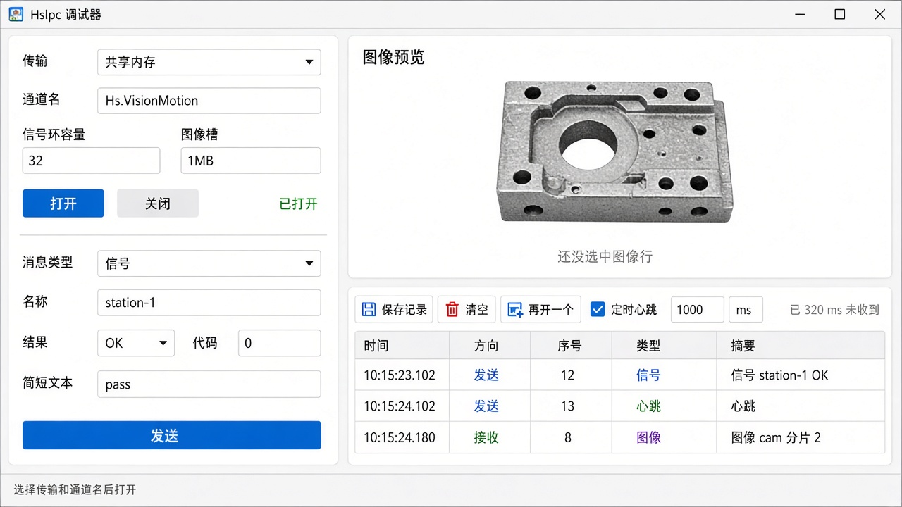

# 进程通讯调试器方案

日期：2026-11-07

对应库：`HsIpc`（共享内存、命名管道、消息队列、TCP 套接字）。本调试器是独立的带界面程序，链接 `HsIpc.dll`，不改库，也不进视觉平台主程序。

界面图：`docs/images/hsipc-debug-ui.png`

## 1. 评估

现场要对一下视觉和运控是不是走在同一条通道上。需要一个像串口助手那样的窗口：选传输、填通道名、发一条、看对端回什么。

单独做一个程序，不塞进 `HsIpc.dll`，也不塞进 `VisionApp`。库保持无界面、无 Qt。调试器可以单独拷到运控电脑上，只要旁边有 `HsIpc.dll`。

和普通通讯调试器拆开。两边报文不一样：这边是定长帧头加 Signal / Stats / Image / File；那边是串口字节流和 Modbus。合在一个窗口里，参数区会互相挡。

四种传输共用一套收发界面。差别只在打开参数：共享内存要容量和槽大小，套接字要地址和端口，管道和队列只要通道名。中途不换传输，和库的约定一致。

接收不能堵在界面线程上。`poll` 会等到超时，按钮一点就卡窗口。收包放到工作线程，再把结果送回界面。调用走头文件里的 `HsIpc::Session`，不直接调导出的 C 函数。

## 2. 界面



配色在本工程的 `debug_theme.h`，不和设备通讯调试器共用。程序图标是两个连在一起的方块。

窗口分成左右两块。

- 左侧上方是打开。传输、通道名、信号环容量、图像槽。共享内存显示容量和槽；套接字改成主机和端口；管道和队列只留通道名。打开后状态变绿，关闭前不能改这些项。
- 左侧下方是发送。消息类型一换，下面的输入跟着换。信号是名称、结果、代码、文本。统计是若干键值。图像和文件是选文件，加上名称。心跳、Hello、Ack、Bye 没有正文，只留发送。
- 右上是图像预览。点表格里的图像行才显示。没有选中图像时写明还没收到图像。
- 右下是收发记录。工具条有保存记录、清空、再开一个、定时心跳和间隔。右侧用 `Session::lastRecvMs` 显示多久没收到。表格列是时间、方向、序号、类型、摘要。管道、队列和套接字上，图像或文件超过 1MB 时，发送摘要写明拆成几片，接收摘要带分片序号。

图里的信号页是默认页。统计、图像、文件只换左侧那张表单，窗口骨架不动。再开一个会另起进程，通道名相同即可对打，谁先打开谁创建。

## 3. 项目位置

加在 `VisionPlatform/VisionPlatform.sln` 的 ClassLib/Port 下，新工程 `HsIpcDebug`，输出 `HsIpcDebug.exe`。

```
HsIpcDebug
  main.cpp                 进程入口，装上本工程的 debug_theme.h
  app.rc / app.ico         程序图标
  MainWindow               左右分栏、记录表、预览、心跳和再开一个
  OpenPanel                按传输切换打开参数
  ComposePanel             按消息类型切换发送表单
  SessionWorker            工作线程里持有 HsIpc::Session
```

工程设置与现有库一致：VS2022 v143，C++17，x64，Unicode。界面用 Qt Widgets 5.15。Qt 只出现在这个 exe 里，`HsIpc` 工程不引用 Qt。

链接 `HsIpc.lib`，运行时从 `bin\x64\Debug` 或 `Release` 加载 `HsIpc.dll`。`SessionWorker` 只通过 `HsIpc::Session` 打开、发送和 poll，不碰共享内存布局。

## 4. 设计模式

界面不碰帧字节。`SessionWorker` 是唯一持有 `HsIpc::Session` 的对象。窗口把表单收成 `HsIpcMessage` 投进队列，工作线程 `send` / `poll`，再把已经拷好的行交回窗口。

发送表单按消息类型换输入。信号填 name、result、code、text；图像读文件进 data。窗口只认识这份报文，增加类型时加一张表单，不改窗口骨架。打开参数同样：传输一变，只换 `OpenPanel` 里那几行输入。

接收线程和界面分开。线程里 `poll`，界面定时器把行追加进表格。`poll` 填出的指针只在库里活到下一次 `poll`，所以线程在入队之前先把名称、文本和像素拷走。

传输工厂继续用库里的。调试器不自己 `CreateFileMapping`，也不自己建管道。界面上的四种传输，就是 `HsIpcTransport` 的四个值。

## 5. 功能

- 选择共享内存、命名管道、消息队列、套接字之一，填写通道名。套接字再填主机和端口，主机空则走 127.0.0.1。
- 打开、关闭。失败时把库返回的错误原文显示在状态栏。
- 发送 Hello、心跳、信号、统计、图像、文件、Ack、Bye。
- 接收并记入表格。信号显示名称和 OK/NG。统计显示键值。点图像行可预览 JPEG。文件显示名称和字节数。
- 返回码按库的约定显示：成功、超时、参数错、满、IO、协议、过大。
- 保存记录为 UTF-8 文本，清空记录。关闭窗口时关闭通道。
- 勾选定时心跳后按间隔发送。状态行显示多久没收到。
- 管道、消息队列和套接字上，图像或文件超过 1MB 时，发送摘要写明拆成几片，接收摘要带分片序号。
- 再开一个会另起进程。通道名相同即可对打，谁先打开谁创建。

不做的：改协议、直接看共享内存槽。

## 6. 规划

1. 把 `HsIpcDebug` 加进解决方案，四种传输能打开和关闭，八种报文能发能收。已完成。
2. 记录存盘、定时心跳、分片序号、再开一个进程。已完成。
3. 两个进程对打一遍四种传输，确认界面上的返回码和库一致。
