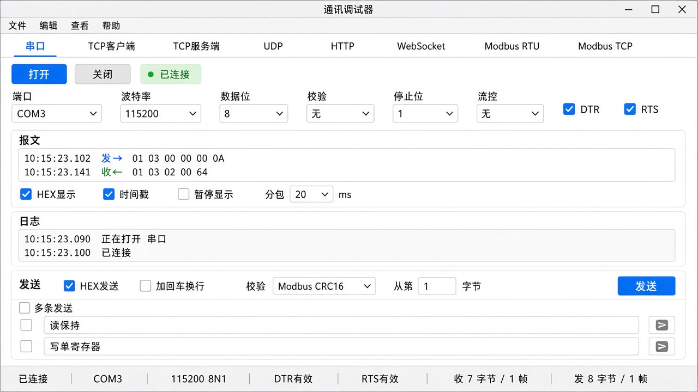
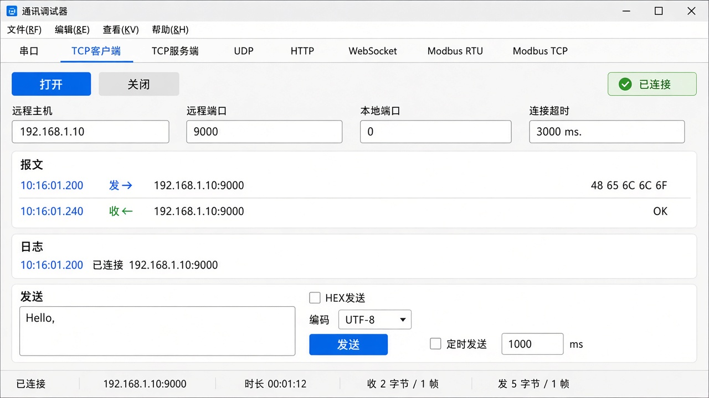
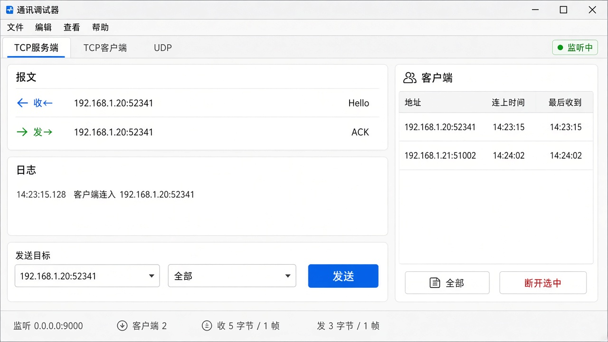
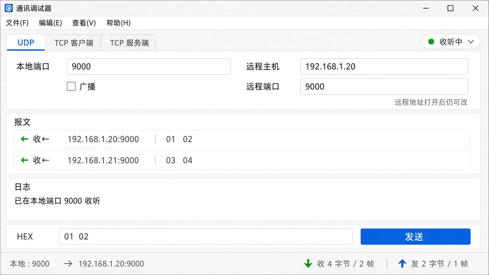
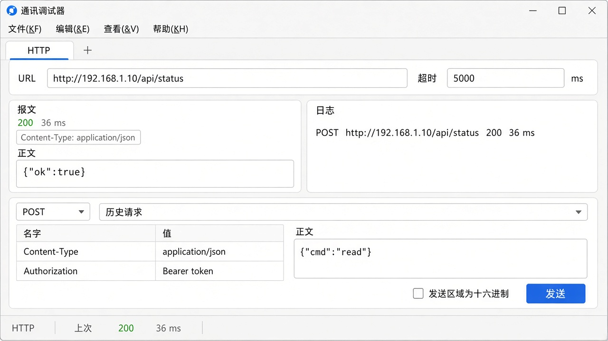
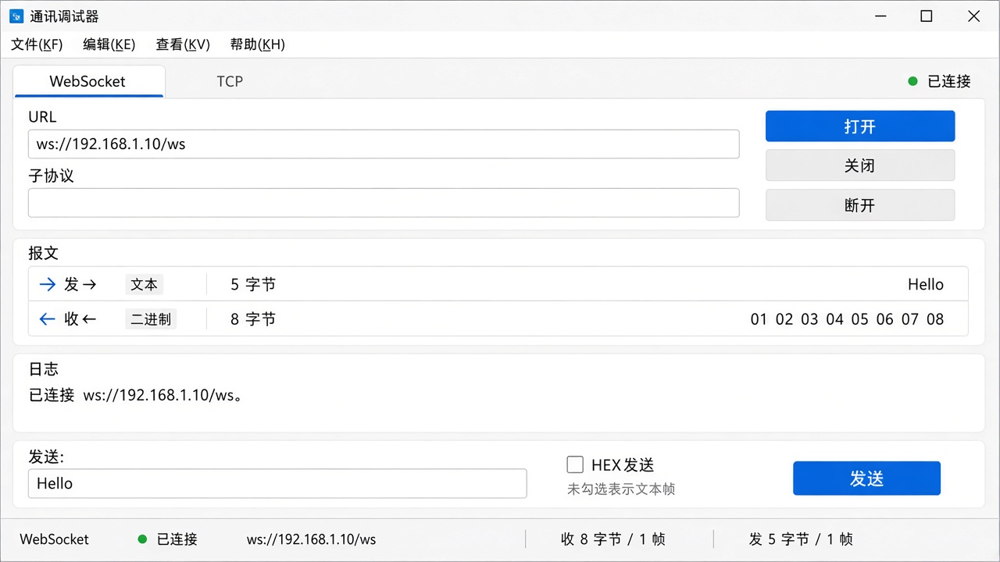
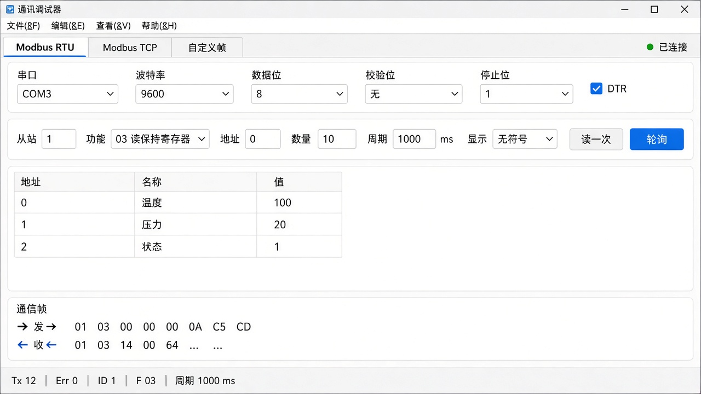
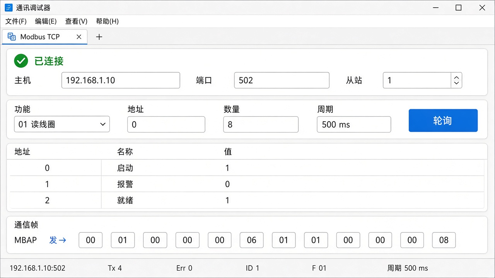

# 通讯调试器方案

日期：2026-11-07，按专业调试助手重写。对应程序 `Vision.PortDebug`。界面按第 4 节实现：八页共用同一套字体、面板边距和按钮。WebSocket 不放子协议，库的握手没有这一项；`wss://` 可以填在 URL 里。

参照：SSCOM（串口、DTR/RTS、分包、多条发送、文件发送、校验范围）、NetAssist（TCP 客户端/服务端、UDP、对端列表、日志模式、历史和预置指令）、Modbus Poll（寄存器表、轮询、功能码、通信帧、错误计数）。不照搬它们的脚本、波形、自定义 CRC 多项式和从站模拟器。

进程通讯调试器 `HsIpcDebug` 不在这一版里。它不是串口网口助手，另有 `docs/进程通讯调试器方案.md`。

## 1. 和现在的差距

现在八个页签共用一块发送框和一块接收框。串口没有 DTR/RTS 和流控，TCP 服务端不能发给全部客户端，也不能踢掉一个连接。UDP 看不出报文从哪来。HTTP 把请求头塞进一个文本框。Modbus 只有四个寄存器功能码，没有线圈，没有轮询，没有寄存器表。校验不能排除帧头帧尾。接收按读到的碎包直接刷行，不能按静默间隔拼成一帧。

专业工具的骨架是固定的：菜单、状态栏、报文区、日志、发送。变的只是每一页的参数和发送含义。下面按这个骨架写。

## 2. 窗口骨架

菜单始终在。

| 菜单 | 项 |
|---|---|
| 文件 | 保存报文、保存日志、接收另存为文件（开始/停止）、退出 |
| 编辑 | 清空报文、清空日志、计数清零 |
| 查看 | HEX 显示、时间戳、暂停显示、自动滚屏、分包显示 |
| 帮助 | 关于 |

状态栏始终在，字段随页变化，见各页。左边是连接状态和这条通道的摘要，右边是收发字节、收发帧、错误次数。数字只在「计数清零」时归零，换页和重新打开不清。

报文区占中间大部分，等宽字体。一行是一帧，不是一次 `read` 的碎块。行首是时间、方向（发→ / 收←）、对端。HEX 显示和时间戳只影响之后的新行，不改已经写下的行。暂停显示时新报文仍计数、仍可写入接收文件，只是不往报文区追加。报文区超过 200KB 时丢掉最旧的，状态栏提示，避免窗口卡死。要留全量就用「接收另存为文件」，那个文件是原始字节，不带时间戳。

日志在报文区下面，矮一条。只记操作和失败：正在打开、已连接、已断开、发送失败、校验错误、踢掉客户端。不把报文正文再抄一遍。

发送区在日志下面。字节通道（串口、TCP、UDP、WebSocket）共用第 3 节。HTTP 和 Modbus 换成自己的发送区，多条发送和末尾校验隐藏。

右侧是这一页的上下文。没有上下文的页把右侧收起来。

一次只打开一条通道。换页签之前必须关闭。

八页的界面在第 4 节。页签始终是这八个，有的简图只画出了当前页附近的页签。

## 3. 字节通道共用的发送

适用于串口、TCP 客户端、TCP 服务端、UDP、WebSocket。

- HEX 或文本。HEX 接受 `01 03` 和 `0103`。文本可选 UTF-8 或 GBK。
- 加回车换行只对文本有效。另有「AT 自动回车」：正文以 `AT` 开头且末尾还没有 `\r\n` 时补上。
- 转义：`\r \n \t \0 \xHH \\`。只对文本有效。
- 末尾校验：不加、累加和、异或、Modbus CRC16（低字节在前）。可填从第几个字节开始、到倒数第几个字节结束，用来跳过帧头和帧尾。默认整帧。
- 定时发送：间隔 20 ms 到 60 s。勾上后按钮变成停止。
- 发送文件：按 256 字节一块写出，块间延时可选 0、1、10、50、100 ms。发送中可停止。
- 历史：主发送框成功发出的内容留下 32 条，点一条填回发送框。从多条发送、历史本身、定时发送出去的不重复入库。
- 多条发送：16 行。每行有名称、HEX 勾选、内容和自己的间隔。名称显示在该行按钮上。循环时跳过空行，按各行间隔依次发。行和历史存在本机。
- Ctrl+Enter 发送当前框。

分包显示：静默超过设定毫秒才把缓冲打成一行。默认 20 ms，可改 1 到 1000。TCP 服务端和 UDP 的一行还要带上来源地址，来源一变也强制换行。

## 4. 各页

### 4.1 串口

参数：端口（下拉，旁边刷新）、波特率（9600、19200、38400、57600、115200、921600，也可手填）、数据位 7 或 8、校验无/奇/偶、停止位 1 或 2、流控无/RTS/CTS。DTR、RTS 两个勾选，默认都有效。打开后这些参数锁住，DTR 和 RTS 仍可改。

右侧不显示。

状态栏：`COM3  9600 8N1`，加上 DTR、RTS 是否有效。

这一页要改库。现在串口把 DTR、RTS 固定拉高，也没有流控参数。界面上的勾选必须真的改线电平，否则不要画出来。

### 4.2 TCP 客户端

参数：远程主机、远程端口、本地端口（0 表示系统分配）、连接超时毫秒（默认 3000）。

右侧不显示。连上之后状态栏写远程 `IP:端口` 和已连接时长。

发送用第 3 节。报文行的对端就是这个远程地址。

### 4.3 TCP 服务端

参数：监听地址（默认 `0.0.0.0`）、监听端口。

右侧是客户端列表。每行：`IP:端口`、连上的时间、最后一次收到数据的时间。选中一行作为发送目标。列表上方有「全部」和「断开选中」。断开选中只踢这一条连接，监听继续。新连接进来、正常断开，列表马上更新。异常断开时，超过 30 秒没有任何数据的连接标灰，可手动断开。

发送目标没选中时，发送按钮无效，并在日志写明。选「全部」时，同一段字节依次写给当前每个客户端，报文区每个客户端一行「发→」。

收到的每一行带该客户端地址。

状态栏：`监听 0.0.0.0:9000  客户端 2`。

### 4.4 UDP

参数：本地端口、远程主机、远程端口。另有「广播」。勾上后远程主机改为本网段广播地址，库必须允许 `SO_BROADCAST`。若现在套接字没开这个选项，这一项跟 DTR 一样，先补库再做界面。

无连接，没有「已连接」。打开表示开始在本地端口收。远程主机和端口在打开后仍可改，下一发用新地址。

报文行带来源 `IP:端口`。来源和当前远程地址不同也照样显示，不丢掉。

状态栏：`本地 :9000  →  192.168.1.20:9000`。

### 4.5 HTTP

参数：URL。超时毫秒，默认 5000。

发送区不用第 3 节。上面是方法：GET、POST、PUT、DELETE。中间是请求头表格，两列名字和值，可增删行。`Content-Type` 和 `Authorization` 是普通行，不再从一段文本里猜。下面是请求体，GET 和 DELETE 时请求体变灰。

没有 HEX、回车换行、末尾校验、多条发送。历史留下最近 16 次完整请求（方法、URL、头、体），点一条填回。

报文区一次请求一块：第一行状态码和耗时，接着响应头，再是正文。失败写日志，不往报文区塞空正文。

状态栏：`HTTP  上次 200  36 ms`。还没请求过则是 `HTTP  尚未发送`。

### 4.6 WebSocket

参数：URL（`ws://` 或 `wss://`）、子协议（可空）。

打开即连接。发送区旁边有「断开」，只关这条连接，页签仍锁着，要换页必须再点关闭。

发送用第 3 节，但没有文件发送。不勾 HEX 时发文本帧，勾选时发二进制帧。报文行标明「文本」或「二进制」以及字节数。

状态栏：`WebSocket  已连接  ws://192.168.1.10/ws`，或 `已断开`。

库若没有子协议和 wss，界面上先不要放对应输入。确认时对一下 `VisionPort` 的 WebSocket 实现再定。

### 4.7 Modbus RTU

上半是串口参数，和第 4.1 节相同，含 DTR/RTS。

下半是轮询定义，对齐 Modbus Poll 的读/写定义，不另开菜单：

| 项 | 默认 | 说明 |
|---|---|---|
| 从站 | 1 | 1 到 247 |
| 功能 | 03 读保持寄存器 | 01 读线圈、02 读离散、03 读保持、04 读输入 |
| 地址 | 0 | 协议地址，从 0 起。旁边注明：设备地址 40001 填 0 |
| 数量 | 10 | 线圈最多 2000，寄存器最多 125 |
| 周期 | 1000 ms | 0 表示不自动轮询，只在点「读一次」时读 |
| 显示 | 无符号 | 无符号、有符号、十六进制。只影响寄存器格 |

中间是表。寄存器：地址、名称、值。名称可改，存在本机，方便记「温度」。线圈：地址、名称、0 或 1。

写：双击保持寄存器或线圈的值。保持寄存器用功能码 06。一次改多格再点「写入」用功能码 16。线圈一个用 05，多个用 15。离散输入和输入寄存器不能写，双击无反应。

「读一次」立即读。「轮询」按周期读，按钮变成停止。轮询中改地址或数量，停一下再按新定义读。

报文区不刷每一拍的寄存器数字，避免把表盖住。表本身就是当前值。报文区改成通信帧：每一拍两行，发→ 和 收← 的 HEX。失败时收← 换成异常码。日志记超时和异常码，不记成功的每一拍。

状态栏照 Modbus Poll：`Tx 12  Err 0  ID 1  F 03  周期 1000 ms`。

库已经能读写真线圈和寄存器。这一页主要是界面，不必再加功能码。

### 4.8 Modbus TCP

和第 4.7 节同一张表、同一种轮询和写入。参数换成主机、端口（默认 502）、从站（单元标识，默认 1，允许 0）。没有波特率和 DTR。

状态栏多写远程 `IP:502`。通信帧是带 MBAP 的整帧，仍由库把发出和收到的字节交回来。

## 5. 这一版做，和明确不做

确认后做：

- 第 2 节的菜单、状态栏、报文、日志、分包。
- 第 3 节的发送，含校验范围、发送文件、16 行带名称的多条发送。
- 八页按第 4 节。其中 DTR/RTS、流控、UDP 广播要先补库，界面和库同一批做。
- Modbus 的线圈、寄存器表、轮询、通信帧、Tx/Err 计数。

不做：

- 自定义 CRC 多项式、发送脚本、波形。
- Modbus ASCII、从站模拟器、浮点和 32 位拼字。需要时用显示格式以后再加。
- 自动应答规则。NetAssist 有，本版不进，避免和多条发送缠在一起。
- 把参数写回视觉方案台账，或在调试器里跑工站。
- 同时打开多条通道。

## 6. 确认

请看这几件事是否按这个做：

1. 报文和日志分开。报文按静默间隔分包，默认 20 ms。
2. 串口要真的能改 DTR、RTS 和流控，为此改 `VisionPort` 的串口。
3. TCP 服务端可以发给选中的一个，也可以发给全部，并能断开选中。
4. Modbus 用寄存器/线圈表加轮询，不再用逗号分隔的数值框。功能码含 01、02、05、15。
5. HTTP 用请求头表格。WebSocket 的子协议和 wss 以库的实际能力为准。
6. 自动应答、自定义 CRC、从站模拟器这次不做。

点头之后再改程序。界面以第 4 节这八张图为准。`docs/images/comm-debug-ui.png` 是上一版窗口，不再作为本方案的界面。
