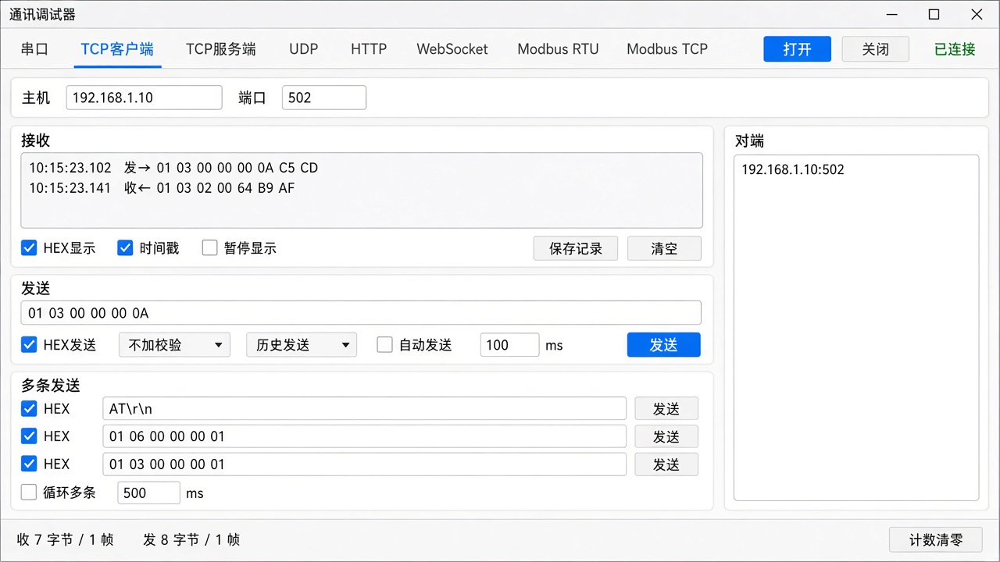

# 通讯调试器方案

日期：2026-11-07

对应库：视觉平台里的 `VisionPort`（串口、TCP 客户端、TCP 服务端、UDP、HTTP、WebSocket，协议为原始字节或 Modbus）。本调试器是独立的带界面程序，用来打开一条通道、发字节、看回包。不替代平台里的通道台账，也不改 `VisionPort`。

界面图：`docs/images/comm-debug-ui.png`

## 1. 评估

平台里已有通信管理窗口，它管的是方案里的通道：要先有方案、权限和台账，才能收发。现场查线、对 PLC、对扫码枪时，往往还没进方案，只想选个串口或填个 IP 看字节。这个调试器就是干这件事的，用法对齐常见的串口网口助手。

和进程通讯调试器分开。`VisionPort` 走的是设备字节流和 Modbus 寄存器。`HsIpc` 走的是本机进程帧。放在同一个窗口里，串口参数和共享内存槽会缠在一起，两边都不好用。

调试器直接调 `CommMgr`：枚举串口、按 `CommChannel` 打开、`send`、读对端。Modbus 仍挂在通道上，调试器只是帮人填从站、功能码和寄存器，不自己组 TCP。这样和平台运行时用的是同一条发送路径，调试器里能通，平台里同一套参数也能通。

`VisionPort` 会带上 `VisionCore` 里的通道和参数类型。调试器工程引用这两个库，不引用 `VisionUi`，也不启动工站和流程。

收包在工作线程里读，不是界面线程。字节先拷进队列，再由定时器刷到接收框。

## 2. 界面



配色在本工程的 `debug_theme.h`，不和进程通讯调试器共用。程序图标是一根线缆。

窗口从上到下是页签、当前通道参数、接收、发送、多条发送。右侧是对端。状态栏常驻收发计数。

页签：串口、TCP 客户端、TCP 服务端、UDP、HTTP、WebSocket、Modbus RTU、Modbus TCP。打开后页签锁住。图中是 TCP 客户端页，主机和端口在页签下面。换页只换这一块参数，接收区留在原处。

- 串口：端口、波特率、数据位、校验、停止位。
- TCP 客户端：主机、端口。
- TCP 服务端：本机端口。右侧列出已接入的客户端，发送前先选一个。
- UDP：本机端口、目标地址和端口。
- HTTP：URL 在参数页。发送区换成方法、请求头和请求体。接收区显示状态码和正文。
- WebSocket：URL。发送区多一个断开。不勾 HEX 时发文本帧。
- Modbus RTU / TCP：参数页是串口或主机端口。发送区换成从站、功能码、地址、数量。写寄存器时在正文里用逗号分隔数值。接收区显示寄存器值，下面可折叠原始字节，里面是发出和收到的整帧。

接收区是等宽字体。勾上 HEX 显示和时间戳后，新行按这个格式写。每行以「发→」或「收←」开头。暂停显示只停追加，计数继续。保存记录写成 UTF-8 文本。清空只清屏幕。

字节通道和 WebSocket 的发送可以勾 HEX、加回车换行、转义（`\r \n \t \0 \xHH`）、选 UTF-8 或 GBK，并在末尾加累加和、异或或 Modbus CRC16。HEX 写成 `01 03` 或 `0103` 都可以。Ctrl+Enter 发送当前框。历史发送点一条就填回发送框。自动发送按间隔重复当前框。

多条发送有六行，每行自己决定是不是 HEX。循环多条按间隔依次发非空的行。这六行和历史记在本机，下次打开还在。

状态栏右侧是收、发的字节数和帧数，计数清零只清数字。

## 3. 项目位置

加在 `VisionPlatform/VisionPlatform.sln` 的 ClassLib/Port 下，新工程 `Vision.PortDebug`，输出 `Vision.PortDebug.exe`。和 `HsIpcDebug` 放在同一个解决方案文件夹里，两个工程互不链接。

```
Vision.PortDebug
  main.cpp                 进程入口，装上本工程的 debug_theme.h
  app.rc / app.ico         程序图标
  MainWindow               页签、接收、发送、多条发送、对端、计数
  channel_page.h           ChannelPage 及八个 createXxxPage
  channel_session.h        工作线程里调用 CommMgr
  byte_text.h              HEX、转义、末尾校验
```

工程设置：VS2022 v143，C++17，x64，Unicode，Qt Widgets 5.15。引用 `VisionPort` 和 `VisionCommon`。输出目录与 `HsIpc` 的 `bin\x64\<Configuration>` 对齐。

## 4. 设计模式

窗口只通过 `ChannelSession` 碰通信库。打开时，当前参数页交出一个 `CommChannel`。发送时交出一段已经按 HEX、转义、编码和校验收好的字节，或一份 Modbus 请求，或一次 HTTP 交换。`CommMgr` 负责真正开关通道。调试器不复制串口和套接字代码。

八种通道各是 `ChannelPage` 的一页。基类说明这一页是字节流、HTTP、WebSocket 还是 Modbus。主窗口拿着当前页，类型切换只换页。后加通道类型时加一页。

`ChannelSession` 是工作线程。界面把打开、发送、HTTP、WebSocket 和 Modbus 投进队列。字节通道由线程按超时去 `readBytes`，WebSocket 去 `wsRecv`。收到的内容先拷成字符串再入队，界面定时器取走后追加。暂停显示时仍然取走，只是不往接收框里写。

Modbus 页不另开传输。它先按串口或 TCP 打开通道，再把功能码和寄存器交给 `CommMgr` 上已有的读写。RTU 和 TCP 是两种参数页，底下仍是库里的通道加协议。原始帧由库把发出和收到的 ADU 交回来，界面放进可折叠区。

## 5. 功能

八种通道都能打开、发送、看回包。

- 串口列出本机端口，设置波特率、数据位、校验、停止位。
- TCP 客户端连接主机和端口。TCP 服务端监听，右侧列出客户端，发送前先选一个。
- UDP 指定本地端口和目标地址后收发。
- HTTP：方法、URL、请求头、请求体。`Content-Type` 和 `Authorization` 随这次请求发出。接收区显示状态码和正文。
- WebSocket：打开即连接，可发文本帧或 HEX 二进制帧，断开即关掉这条连接。
- Modbus RTU 和 Modbus TCP：读保持寄存器、读输入寄存器、写单寄存器、写多寄存器。接收区显示寄存器值，原始字节区可折叠。
- 接收可切 HEX 和时间戳，可暂停显示，可保存记录，可清空。记录区分「发→」和「收←」。
- 字节发送可加回车换行、转义、UTF-8 或 GBK，以及累加和、异或、CRC16。可按间隔自动发当前框。Ctrl+Enter 发送。
- 历史发送和六条常用指令记在本机。多条可循环。
- 状态栏累计收发字节和帧数。打开失败时显示 `CommMgr` 返回的原因。

不做的：把这次打开的参数写回视觉方案台账；在调试器里跑工站或流程；同时打开十几条通道做压力测试；自己开关 DTR/RTS；自定义 CRC 多项式；从文件灌数据。一次只开一条，关了再开下一条。

## 6. 规划

1. 工程加入解决方案，八种通道能打开、发送、在接收区看到回包。已完成。
2. HEX、时间戳、自动发送、HTTP 请求头、WebSocket 断开、Modbus 四种功能码和原始字节区。已完成。
3. 按串口网口助手补上方向标记、暂停、保存、回车换行、转义、编码、末尾校验、历史、多条循环和收发计数。已完成。
4. 用一台实际从站或从站模拟器对一次读保持寄存器，看寄存器值和原始字节是否和手册一致。
5. 和平台通信管理窗口用同一组串口参数各发一次，确认两边行为一致。
